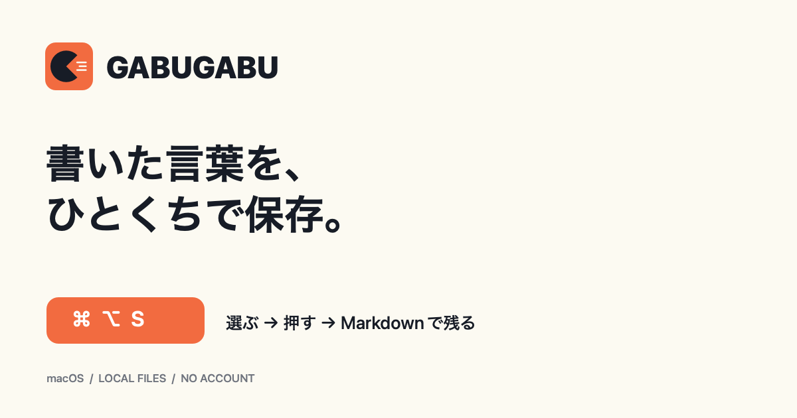
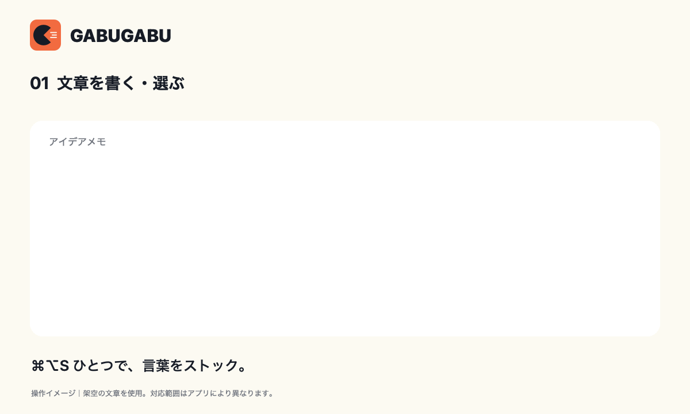

# GABUGABU

**書いた言葉を、ひとくちで保存。**



AIへのプロンプトも、ページで見つけた一節も、書きかけの考えも。選んで **Command + Option + S** を押すだけで、自分のMacにMarkdownで残せる小さなアプリです。気になる言葉をどんどんためて、あとでAIに読ませるメモに。

**[Mac版をダウンロード →](https://github.com/hrk877/gabugabu/releases/latest)**

macOS 13以降 / Apple Silicon・Intel両対応 / 無料・MIT License

## どう使う？

1. [Releases](https://github.com/hrk877/gabugabu/releases/latest) の **GABUGABU-1.3.3-mac.zip** をダウンロードして展開。
2. **GABUGABU.app** を「アプリケーション」へ移して開く。
3. 初回だけ「アクセシビリティ設定を開く」から **GABUGABU** を許可する。
4. 普段のアプリに戻り、文章を選択して **⌘⌥S** を押す。

入力中の文章は、何も選択していなければ入力欄全体を保存します。「保存しました」と出たら完了。アプリを開いてノートを作ったり、タイトルを付けたりする必要はありません。



デモは架空の文章を使った操作イメージです。口と記録の一覧は「選んだ言葉がたまる」様子の表現で、実際のアプリはメニューバーから使います。文章以外の画像・音声・動画は保存しません。

## どこに残る？

**GABUGABU Archive** に日付別で追記します。

```text
~/GABUGABU/Archive/
├── 2026-10-26.md
├── 2026-10-27.md
└── …
```

原文に加え、日時・アプリ名・記録ID・選択／全文の区別を記録。画面タイトル・ページURL・書類パスも、取得できる場合は自動で付けます。取れない項目は空欄です。同じ文章でも、押した回数だけ保存します。日付はMacのタイムゾーン、各記録の時刻はUTCです。

AIにローカルファイルを読む権限があれば「GABUGABU Archiveから、先週のアイデアを探して」と頼めます。通常のChatGPTが自動でこのフォルダーへ接続されるわけではありません。クラウドAIに読ませた内容は、そのAIに送られます。

## 対応範囲

- macOSのアクセシビリティで取得できる選択文と、編集可能な入力欄が対象です。
- Webページや書類の選択文にも対応しますが、アプリによって取得できない画面があります。
- 選択文が取れないとき、読み取り専用ページを丸ごと保存することはありません。
- URLやタイトルの取得可否もアプリ次第です。URLを得るために別のタブや履歴を探すことはありません。
- パスワード欄と主なパスワード管理アプリは対象外。通常の文章中の秘密情報を自動で見分ける機能はありません。
- ショートカットが他アプリと重なる場合は、そちらの設定を変更してください。

## ローカル保存について

GABUGABU自体の外部通信・アカウント・AI API・課金はありません。キー入力の常時記録やクリップボードの操作もしません。ショートカットを押したときだけ読み取ります。

記録は平文Markdownです。新規フォルダーは所有者だけアクセス可能（700）、ファイルは所有者だけ読み書き可能（600）。同じユーザー権限を持つアプリやバックアップから読める場合があり、自分で同期対象にすればクラウドにも同期されます。

## 初回の警告・権限設定

この配布版はアドホック署名で、Apple Developer ID署名・公証は未実施です。ダウンロード後、macOSに起動を止められる場合があります。入手元を確認したうえで「システム設定 → プライバシーとセキュリティ → このまま開く」から許可してください。OSのバージョンによって表示は異なります。

アクセシビリティ一覧に見つからない場合は「＋」からGABUGABU.appを追加します。更新後、オンなのに権限エラーが出るときは、一覧から一度「−」で削除し、現在のアプリを追加し直してください。

起動後はメニューバーの「文章＋」アイコンから保存先・使い方・終了を選べます。ログイン時にも起動したい場合は、macOSのログイン項目に追加してください。

## 旧版「ことばログ」から

旧アプリを終了してからGABUGABUを起動してください。旧保存先 `~/PromptArchive/` は、新しい `~/GABUGABU/Archive/` へ自動で移します。両方の保存先がすでに存在する場合、旧記録はArchive内の `Imported-PromptArchive-…/` に保管し、同じ日付のファイルを上書きしません。旧形式のMarkdownもそのまま読めます。

## 自分でビルド

Xcode Command Line ToolsがあるMacで実行。外部ライブラリー不要です。

```bash
/bin/bash test.sh
/bin/bash build.sh
```

`dist/GABUGABU.app` と `dist/GABUGABU-1.3.3-mac.zip` が生成されます。テストは保存・同時追記・選択ポリシー・メタデータ・記録移行・パス検証・取得期限を確認します。取得期限のテストは外部AX APIを代役に置き換えて実際のCapture処理を実行するもので、実アプリの互換性を保証するものではありません。実際のアプリ間取得は権限設定後に別途確認してください。

不具合は [Issues](https://github.com/hrk877/gabugabu/issues) へ。実際の保存内容や個人情報をそのまま貼らず、再現する画面と手順を教えてください。

## English

GABUGABU is a small macOS menu bar app that saves selected text—or the current editable input—to local daily Markdown files with **Command + Option + S**. It automatically adds source metadata when available. No network, account, AI API, clipboard changes, or continuous key logging. macOS 13+, Apple Silicon and Intel. Accessibility permission is required. This build is ad-hoc signed and not Apple-notarized; compatibility depends on each app's Accessibility support.

MIT License.
